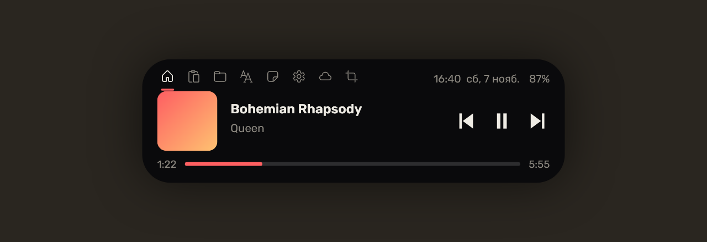
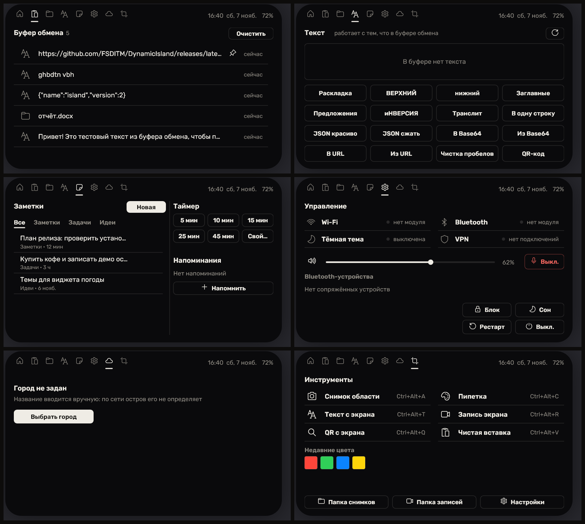
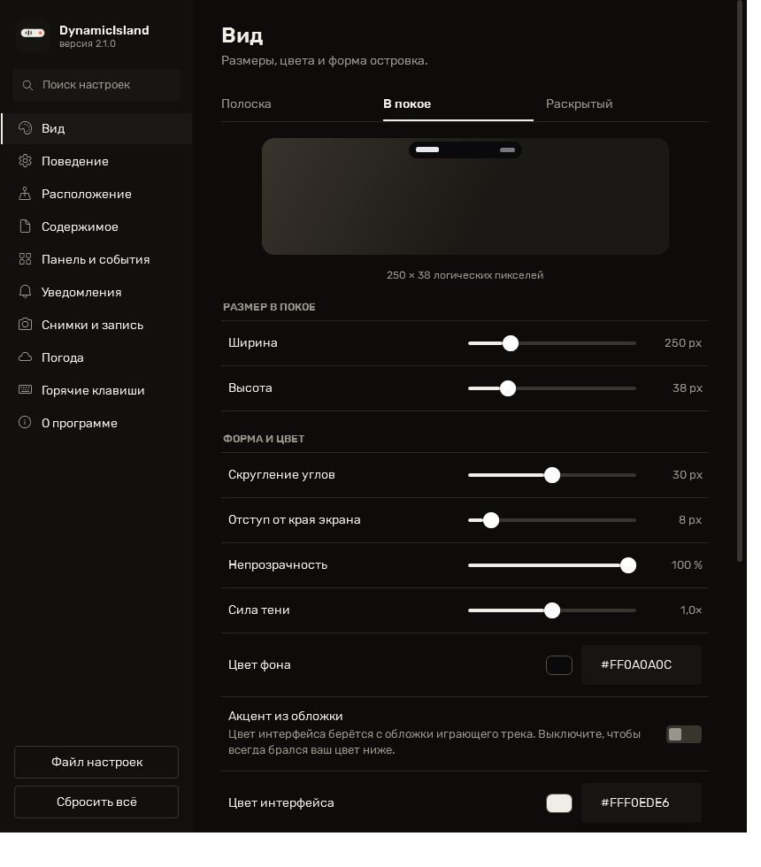
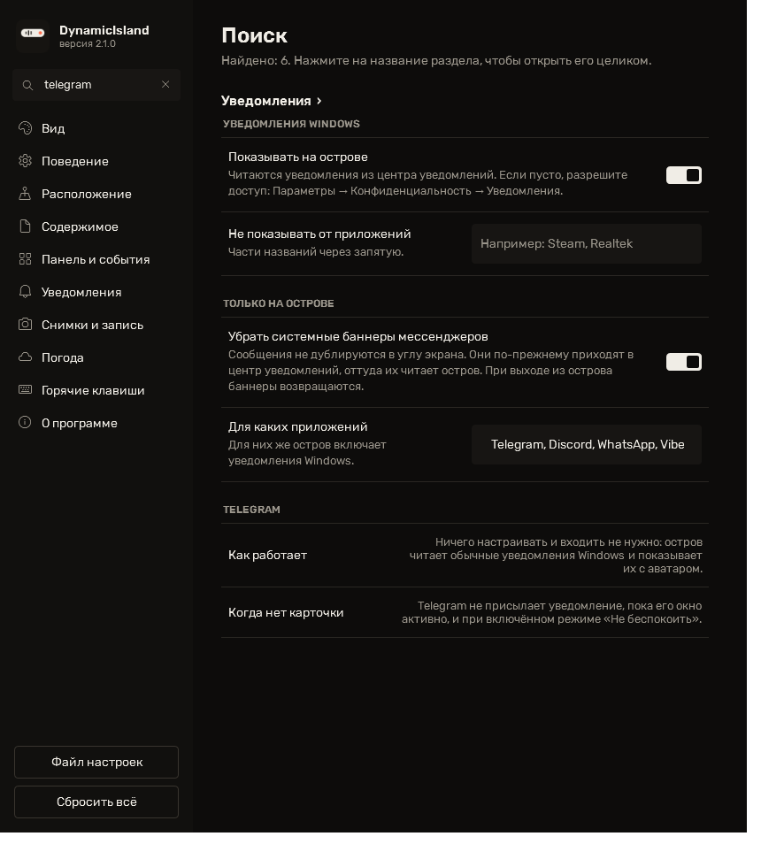
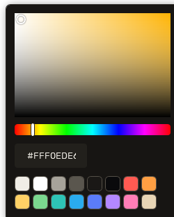
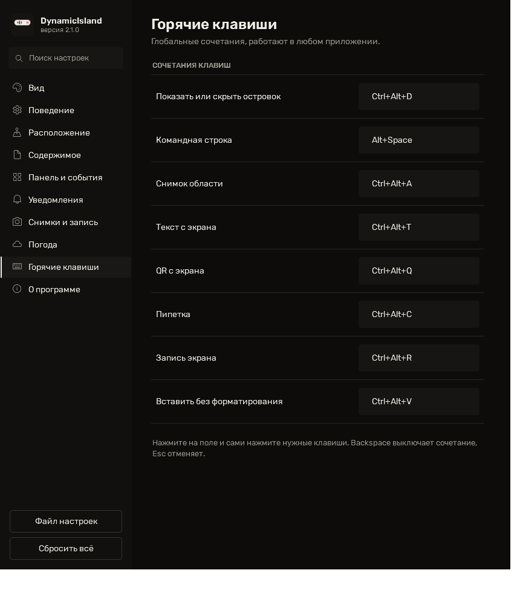
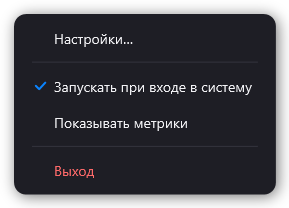

<div align="center">



<h1>DynamicIsland</h1>

<p><b>Динамический островок для Windows.</b><br>
Часы, плеер и инструменты у верхней кромки экрана:<br>
буфер обмена, полка, заметки, снимки, запись, командная строка.<br>
Direct3D 12 и ноль процессора в покое.</p>

<p>
<a href="https://github.com/FSDITM/DynamicIsland/releases/latest"></a>


</p>

<p>
<a href="#что-это">Что это</a> ·
<a href="#возможности">Возможности</a> ·
<a href="#настройки">Настройки</a> ·
<a href="#установка">Установка</a> ·
<a href="#почему-быстро">Быстродействие</a> ·
<a href="#сборка-из-исходников">Сборка</a> ·
<a href="CHANGELOG.md">История версий</a>
</p>

</div>

<br>

## Что это

Островок живёт у верхней кромки экрана. В покое показывает время и то, что
происходит сейчас: музыку, таймер, запись, VPN. При наведении раскрывается в
панель с вкладками — от плеера до снимков и командной строки. Когда мешает,
сворачивается в тонкую полоску или исчезает совсем.

<div align="center">
  
</div>

## Возможности

🎵 &nbsp;**Плеер.** Обложка, название, исполнитель, пауза, переключение треков
и полоса перемотки — через штатный `GlobalSystemMediaTransportControls`.
Работает со Spotify, браузерами и любыми плеерами без плагинов.

✨ &nbsp;**Показ нового трека.** При смене песни островок сам раскрывается
на несколько секунд и сворачивается обратно.

🪟 &nbsp;**Умная адаптация формы.** Сворачивается в полоску только под теми
приложениями, которым реально мешает — по умолчанию под браузерами, у них
сверху вкладки. Терминалу эта полоса экрана не нужна, и там островок остаётся
целым. В полноэкранном режиме убирается совсем.

🖱️ &nbsp;**Не перехватывает чужие клики.** Окно сжато регионом до самой фигуры
островка: за её пределами приложения для системы просто нет.

⚙️ &nbsp;**Настройки с поиском.** Размеры каждого состояния, цвета с палитрой, скругление,
прозрачность, задержки, выбор монитора, состав содержимого, горячие клавиши.
Всё применяется сразу, кнопки «Сохранить» нет. [Подробнее](#настройки).

### Вкладки (2.0)

📋 &nbsp;**Буфер.** История текста, картинок и файлов, закрепление, вставка кликом
без отъёма фокуса. Пароли из менеджеров паролей в историю не попадают.

🗂️ &nbsp;**Полка.** Бросьте файлы на островок и достаньте в нужном окне.

🔤 &nbsp;**Текст.** Раскладка, регистр, транслит, JSON, Base64, URL, QR-код.

📝 &nbsp;**Заметки, таймер и напоминания.** Заметки с форматированием и задачами
по папкам; «напомни позвонить маме завтра в 9»; таймер живёт в пилюле.

🎛️ &nbsp;**Управление.** Wi-Fi, Bluetooth, тёмная тема, VPN, громкость, микрофон,
блокировка, сон, перезагрузка.

🌦️ &nbsp;**Погода.** Сейчас, часы и неделя без ключей и регистрации; температура
в пилюле и предупреждение о дожде.

🛠️ &nbsp;**Инструменты.** Снимок области с разметкой, текст и QR с экрана,
пипетка с лупой, запись экрана в MP4 или GIF. Сам островок на снимках
отсутствует (это можно изменить).

⌨️ &nbsp;**Командная строка** на `Alt+Space`: программы, файлы, калькулятор,
единицы и валюты, таймер, напоминания, команды системы и `> команда` для
PowerShell. Все сочетания меняются в настройках.

💬 &nbsp;**Уведомления и Telegram.** Уведомления Windows карточкой на острове с аватаром,
в том числе Telegram; системные баннеры мессенджеров можно убрать, оставив только остров.

🔔 &nbsp;**События в пилюле.** Микрофон и камера в работе, загрузки, раскладка,
Caps Lock, VPN со страной, Steam, запись и трансляция в OBS.

🎤 &nbsp;**Слова песни.** Строка с текстом едет по острову в темпе песни: плавный разгон,
ровный ход и торможение, синхронно с тем, что играет.

<br>

## Настройки

Окно настроек устроено как системное: разделы слева, карточки справа, всё применяется
мгновенно. Над меню — **поиск**: он ищет по названиям, подсказкам и ключевым словам во всех
разделах сразу, а найденные переключатели работают прямо в выдаче. `Ctrl+F` ставит курсор в поле.

<div align="center">
  
  
</div>

**Палитра цвета.** Фон, цвет интерфейса, эквалайзера и значков выбираются нажатием
на образец: квадрат насыщенности, полоса оттенка, код `#RRGGBB` и готовые цвета. Для эквалайзера
и значков есть «Авто».

**Горячие клавиши записываются нажатием.** Не нужно набирать `Ctrl+Alt+A` текстом: кликните
в поле и нажмите сами клавиши.

<div align="center">
  
  
  
</div>

<br>

## Установка

1. Скачайте **[`DynamicIsland-setup.exe`](https://github.com/FSDITM/DynamicIsland/releases/latest)**
2. Запустите. Windows SmartScreen покажет предупреждение — установщик не подписан
   сертификатом. Нажмите **«Подробнее» → «Выполнить в любом случае»**
3. При установке можно сразу включить запуск при входе в систему

Права администратора не нужны — приложение ставится в папку пользователя.
**.NET устанавливать не надо**, он уже внутри.

После установки островок появится вверху экрана, а значок — в трее.
Настройки открываются кликом по значку.

**Требуется:** Windows 10 версии 21H2 (сборка 19041) или новее, x64,
видеокарта с поддержкой Direct3D 12 — подойдёт любая с 2015 года.

**Удаление:** Параметры → Приложения → DynamicIsland. Настройки останутся
в `%APPDATA%\DynamicIsland`.

<br>

## Почему быстро

| | |
|---|---|
| **Покой** | 0.06% одного ядра — установленное приложение, курсор вдали от островка |
| **Анимация** | 60 fps, 1.9–2.3 мс процессорного времени на кадр |
| **Первый кадр** | ~100 мс — разовая компиляция шейдеров |
| **Память** | ~87 МБ приватной, ~145 МБ рабочий набор |

<sub>Цифры в таблице измерены для 1.0. В 2.0 фоновые проверки событий добавили
редкие таймеры; на одном компьютере в одинаковых условиях 1.0.6 и 2.0.0 показали
один и тот же расход процессора (0,94 % ядра при активном медиа-сеансе).</sub>

Так вышло не само собой — за этим три решения.

**Окно размером с островок, а не с экран.** Оверлеи часто делают полноэкранным
прозрачным окном. Такое приходится перерисовывать целиком каждый кадр, и оно
накрывает собой весь рабочий стол.

**Кадр не покидает видеопамять.** Окно с `WS_EX_NOREDIRECTIONBITMAP` отдаёт
содержимое напрямую DirectComposition, а рисует его Skia на Direct3D 12.
Обычный путь — layered-окно — гонит каждый кадр через системную память.

**В покое кадров нет вообще.** Пружины анимации сообщают, когда успокоились,
и поток засыпает до следующего события: смена трека приходит из WinRT, смена
активного окна — из `SetWinEventHook`, изменение буфера — от системы. Фоновые
проверки событий (микрофон, загрузки, Caps Lock) редкие и дешёвые, а папку
«Загрузки» никто не перечитывает: за ней следят события файловой системы.

<br>

## Сборка из исходников

Нужен [.NET SDK 10](https://dotnet.microsoft.com/download).

```bash
git clone https://github.com/FSDITM/DynamicIsland.git
cd DynamicIsland
dotnet run --project src/DynamicIsland.App -c Release
```

<details>
<summary><b>Служебные режимы</b> — интерфейс проверяется снимками, а не на глаз</summary>

<br>

| Команда | Что делает |
|---|---|
| `--selftest 8` | гоняет анимацию 8 секунд и пишет метрики в лог |
| `--snapshot <папка>` | рисует все состояния островка в PNG на трёх фонах |
| `--previewsettings <папка> [масштаб]` | отрисовывает окно настроек и меню в PNG |
| `--testmenu` | прогоняет нажатие по пункту меню тем же путём, что и мышью |
| `--icon <ico> [png]` | пересобирает логотип приложения |
| `--banner <png>` | рисует обложку для этого README |
| `--watchtest <секунд>` | пишет в лог все события смены окна и решение по каждому |
| `--mediainfo` | что система знает о воспроизведении и какой источник выберет островок |
| `--mediatest` | прогоняет правило выбора источника по сценариям |
| `--featuretest <файл>` | проверяет разборщики и инструменты (калькулятор, напоминания, единицы, QR, полка) и пишет отчёт |
| `--snaptabs <папка>` | рисует вкладки панели и таблицу значков в PNG |

</details>

<details>
<summary><b>Сборка установщика</b></summary>

<br>

Нужен [Inno Setup 6](https://jrsoftware.org/isdl.php).

```bash
dotnet publish src/DynamicIsland.App -c Release -r win-x64 --self-contained true -o publish
ISCC.exe installer/DynamicIsland.iss
```

Готовый установщик появится в `dist/`. Номер версии он берёт из собранного
`.exe`, а тот — из `<Version>` в `DynamicIsland.App.csproj`: разъехаться они
не могут. Список выпусков — в [CHANGELOG.md](CHANGELOG.md).

</details>

<br>

## Устройство

```
src/DynamicIsland.App/
├── Interop/Win32.cs              P/Invoke: окно, монитор, DPI, DComp, трей, хуки
├── Platform/                     окно оверлея, трей, слежение за окнами, автозапуск
├── Rendering/                    D3D12 + composition swapchain + DComp + Skia
├── Services/                     плеер и батарея через WinRT, на событиях
├── Features/                     буфер, полка, заметки, напоминания, команды, снимки, запись, погода
├── Ui/                           состояния островка, отрисовка, шрифт, логотип, вкладки (Ui/Tabs)
├── Configuration/                настройки, окно настроек, меню в трее
└── Program.cs                    планировщик кадров, метрики, служебные режимы
```

<details>
<summary><b>Как устроен кадр</b></summary>

<br>

Состоянием буфера управляет только этот код — Skia всегда застаёт ресурс
в объявленном ей состоянии:

```
ожидание fence ──► барьер Present → RenderTarget
               ──► Skia рисует
               ──► Flush + Submit
               ──► барьер RenderTarget → Present
               ──► Present(1)
```

Поэтому обёртки `SKSurface` кэшируются на каждый буфер, а не пересоздаются
каждый кадр.

**Почему регион окна, а не прозрачность для мыши.** У окна
с `WS_EX_NOREDIRECTIONBITMAP`, отрисованного через DirectComposition, ввод
не проходит насквозь в принципе: система не имеет доступа к видеопамяти окна
и не может проверить альфу пикселей. Ни `WS_EX_TRANSPARENT`, ни ответ
`HTTRANSPARENT` не работают — единственная настоящая граница это регион окна,
и он строится ровно по видимым пикселям.

</details>

<br>

## Известные ограничения

- Ответить на сообщение Telegram из острова нельзя: Telegram Desktop не даёт открыть чат
  по номеру, а вслепую остров ничего не отправляет. Карточка уведомления только показывает сообщение
- Telegram не присылает уведомление, пока его окно активно и при включённом «Не беспокоить»
- Установщик не подписан сертификатом — отсюда предупреждение SmartScreen
- Слой валидации Direct3D 12 требует компонента Windows «Средства графики»

<br>

## Благодарности

Идея и первая реализация — [DynamicWin](https://github.com/FlorianButz/DynamicWin)
Флориана Бутца. Исходники оригинала были удалены из репозитория в октябре
2025 года; этот проект написан заново, но начался с изучения того кода.

Шрифт [Rubik](https://github.com/googlefonts/rubik) — Hubert and Fischer, Cyreal,
SIL Open Font License.

<br>

<div align="center">
<sub><a href="LICENSE">MIT</a></sub>
</div>
